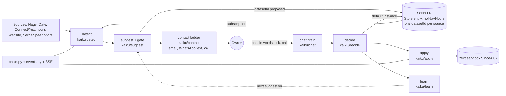

# Architecture

## One picture

## Components and why we chose them
| Component | What it does | Why this choice | Files |
|---|---|---|---|
| Chain and events | Registry of six steps, runs them in order, emits one event per step to SQLite and to Server-Sent Events `/api/events`; `/api/reset` | One place to see the whole chain; the UI, voice and judges all read the same event stream | `kaiku/chain.py`, `events.py`, `store.py`, `schema.py`, `app.py` |
| Orion-LD broker | One `Store` entity per business; `holidayHours` has one instance per source (datasetId) plus a default instance (the resolved truth); two subscriptions start Detect and Decide | The brief's "which data do you trust" is an NGSI-LD feature, not a convention; FIWARE partner track | `kaiku/broker/client.py, models.py, subs.py, router.py, fallback.py` |
| Detect | Holiday calendar (Nager.Date with bundled fallback), signals: regular hours, last year, website, Google via Serper, peers | Each signal is separate so each reason can be shown to the owner | `kaiku/detect/holidays.py, signals.py, engine.py` |
| Suggest | Rule engine with a confidence gate; Finnish and English reasons and message | Rules are explainable and testable; the owner sees exactly why | `kaiku/suggest/engine.py, explain.py, schema.py, backtest.py, cli.py` |
| Contact | A ladder: 1 email with the decision link (SMTP, Zoho; proof 6 Nov 23:48:04Z), 2 after `EMAIL_ESCALATE_AFTER_S` (60 s live, default 120) one plain WhatsApp text that is the same conversation as the website chat (buttons only with `WA_BUTTONS=1`; proof 23:49:08Z), 3 after `WA_ESCALATE_AFTER_S` a call by Kaiku (ElevenLabs agent over a Zadarma SIP trunk, English; proof 21:46:53Z). A decision on any channel cancels the next step | The owner is reached on the channel they read first, never a login | `kaiku/contact/email.py, whatsapp.py, call.py, ladder.py, messages.py, router.py` |
| Chat brain | Anthropic claude-sonnet-5-5 with three tools (decide, standing permission, ask), 40-word cap, deterministic keyword parser fallback; serves the website chat and the WhatsApp replies through one decision path | Owners answer in words, so one brain behind every channel keeps one truth | `kaiku/chat/brain.py, actions.py, feed.py, router.py` |
| Decide | Same decision functions for the chat, WhatsApp, the call webhook and the single-use link `/d/<token>`: approve, edit, decline, reason chips, standing permission | No account on any channel | `kaiku/decide/tokens.py, step.py, router.py` |
| Apply | Reads Yext entity, merges the holiday row, writes, reads back, saves a snapshot, can revert and reset | A write must be checkable; `verified` is true only if the read-back matches | `kaiku/apply/yext.py, publishers.py, cli.py` |
| Learn | Per-business preferences from edits and declines, standing permission, the chain's clock (time travel) | Makes the second suggestion better; time travel makes Christmas demoable in November | `kaiku/learn/prefs.py, timetravel.py` |
| Voice | Push-to-talk on every page: ElevenLabs STT/TTS, Anthropic claude-sonnet-5-5 tool loop | Fast way to drive the demo and answer questions; the model only calls fixed tools | `kaiku/voice/` |
| Map and room | 813 real OSM Turku businesses, QR join, live dots over SSE | Shows the loop at scale with many owners at once | `kaiku/map/` |
| Aura | Föli, AIS and Open-Meteo feeds into Smart Data Models entities; agent proposes geoQ subscriptions, human approves | FIWARE entry: live data as NGSI-LD entities | `kaiku/aura/` |
| ngsi-ld-mcp | Standalone MCP server over the broker; every write is a proposal until a human approves | Agents propose, humans approve, the same rule as Kaiku itself | `ngsi-ld-mcp/` |
| Screens | FastAPI, Jinja2, vanilla JS, no build step | Nothing to compile; judges can read it | `kaiku/web/templates`, `kaiku/web/static` |

## Data flow
1. A subscription on `holidayHoursStatus` fires `POST /broker/notify` when a holiday has status `missing`. That is Detect.
2. `detect` builds the signals; `suggest` applies the gate (first match wins, see [docs/suggest.md](docs/suggest.md)) and returns kind `hours`, `closed`, `no_change` or `ask` with confidence and reasons. The `proposed` instance is written to the broker.
3. `learn.apply_prefs` adjusts the suggestion from earlier edits and declines. `decide.tokens` creates the single-use link.
4. `contact` runs the ladder: email with the link, then one WhatsApp text, then a call. The website chat shows the same suggestions. `no_change` asks for no decision.
5. The owner's tap resolves the waiting decide future. The default instance is written to the broker.
6. `apply` writes the holiday row to Yext, reads it back, emits `where_it_shows`. `learn` records the decision.
Every number on screen comes from these calls; missing data shows "no data" or "unknown".

## What keeps it honest
- Gate and validation: every interval is validated (HH:MM, start before end, no overlap); invalid data is dropped and the gate falls to a question, never to a proposal. A past date gives no suggestion. Maximum confidence without history is 0.65 and the ask threshold is 0.6.
- The owner approves every write. A timeout writes nothing. A decline skips apply.
- Yext: the Management API entity write is used directly because the Suggestions API returns 403 for the sandbox key ([docs/apply.md](docs/apply.md)); local validation (Yext accepted an inverted interval), read-back `verified`, snapshot before every write, revert.
- Google is named in a message only when Serper returned hours; otherwise the text says what Connect shows.
- Tests: `.venv/bin/pytest -q` (362 passed, 6 skipped on 7 Nov 2026, offline: the suite sets `KAIKU_NO_SMTP=1`, `KAIKU_FEED_NETWORK=0` and an empty `WA_TOKEN`; live tests run only with `KAIKU_LIVE=1`). Backtest: `python -m kaiku.suggest.backtest data/sample_cases.json`. Deployed page check: `/root/hack/bin/smoke.py <url>`.

## What breaks first at scale
First: the suggestions engine (`kaiku/suggest/feed.py`, `kaiku/detect/signals.py`) fetches signals per business on every build, the business website and Google via Serper, per holiday in view. One build for the demo clinic measured 6 HTTP calls in 1.6 s warm on 7 Nov 2026 (the fictional website fails fast); a real website per business and more holidays multiply this, and the feed is cached only 30 s (`kaiku/chat/feed.py`). The chat's first paint therefore uses the quick path without network signals. At scale this needs a signal cache per business and a background refresh instead of a fetch on request.

Second: writing a `datasetId` instance on our Orion-LD build is read, delete and re-create (the build answers 501 to in-place writes), one entity at a time under a process lock. That does not scale to thousands of businesses and is not atomic across processes. With a week we would use a build that supports datasetId updates or one entity per business-source pair. Third: the rule engine uses hand-made category priors; it needs Connect's real exception-hours history.

## What we would change with a week
- Run the suggest engine against Fonecta's dataset and scoring script and tune the gate on it.
- Review replies and automatic posts on the same loop (Detect, Suggest, Contact, Decide, Apply is unchanged; the signals and the write target change).
- Replace the file-based preferences and tokens with a database, and publish a Kaiku JSON-LD context for `holidayHours`.
