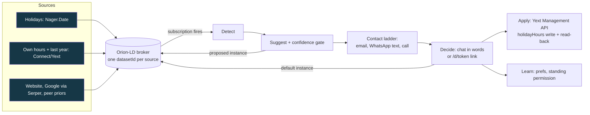

# Kaiku: Connect suggests, the customer approves

**What and for whom.** Kaiku is the whole chain for holiday hours (Detect, Suggest, Contact, Decide, Apply) for the owner of a small business whose opening hours Fonecta Connect publishes. The owner gets a message instead of a login, answers in plain words ("yes", "make it 10-14", "no thanks"), and the approved hours are written to Fonecta's Yext sandbox. The demo business is the **fictional** Furry Paw Vet Clinic, Fonecta's sandbox entity SinceAI07 in Vantaa.

**Live:** <https://kaiku.hankintaviikko.fi> (landing page; the owner's page is `/owner`, phone and laptop) | **Demo video:** <https://youtu.be/Opg_gzlo_II> | **Repo:** github.com/oroomi/kaiku
**Challenge:** Fonecta, "Connect suggests, customer approves" | **Partner technology:** FIWARE (Orion-LD NGSI-LD broker) | **Team:** VY7, solo (Dayo) with Claude coding tools


(Screenshot of the live owner page, 7 Nov 2026, demo clock 17.12.2026: listing score 40 %, three of seven checks, suggestion cards. Details: [docs/owner.md](docs/owner.md).)

## Run it in 3 commands
```bash
git clone https://github.com/oroomi/kaiku && cd kaiku
python3 -m venv .venv && .venv/bin/pip install -r requirements.txt
.venv/bin/uvicorn kaiku.app:app --host 127.0.0.1 --port 8210   # http://127.0.0.1:8210
```
Without keys the chain still runs and each lane says what is missing. Tests: `.venv/bin/python -m pytest -q` gives 466 passed, 7 skipped (the skipped ones send or fetch live and need `KAIKU_LIVE=1`) on 7 Nov 2026 with the box's `.env`. In a fresh checkout without SMTP settings `tests/test_email.py::test_real_smtp_path` also fails (it needs the box's SMTP settings). The suite sets `KAIKU_NO_SMTP=1`, `KAIKU_FEED_NETWORK=0`, `KAIKU_NO_CALL=1` and an empty `WA_TOKEN`, so it never sends, calls or fetches.

## How this meets the brief
Fonecta's slide 8 and slide 7, answered item by item (all numbers re-checked on the live product, 7 Nov 2026):
- **What to submit** (working demo, video, repo, data sources, final messages, cold start, deck, bonus): [docs/SUBMISSION.md](docs/SUBMISSION.md), one row per item with its link.
- **Data sources, production source, what did not work:** [docs/DATA_SOURCES.md](docs/DATA_SOURCES.md). **Final customer messages as text:** [docs/final_messages.md](docs/final_messages.md). **No history:** [docs/COLD_START.md](docs/COLD_START.md). **Pitch deck:** [docs/DECK.md](docs/DECK.md).
- **Evaluation criteria** (suggestion quality, customer experience, reliability, extensibility, learning, all five steps): each answered in one paragraph with evidence at the end of [EVAL.md](EVAL.md). Honest status: Fonecta gave no dataset format and no sample during the event, so suggestion quality is a self-consistency check on 10 cases we wrote. Instead of a fixed format there is a loader that accepts CSV or JSON, and the live page `/eval` where you drop your own file and see every suggestion with its reason and hit rate.
- **Bonus** (a live source replacing a dataset file): [docs/DATA_SOURCES.md](docs/DATA_SOURCES.md) "Bonus".
- **One deliberate difference from Fonecta's example:** the WhatsApp opener has two buttons, Accept and Discard, and an edit is typed ("To change the hours, just reply with them"), instead of Approve / Edit / No thanks. One tap for the two common answers; a typed edit carries the actual hours.

## The three hard questions
1. **Who is it for?** The owner of a small business whose hours Fonecta Connect publishes and who forgets one-off changes such as holiday hours (a vet, a cafe, a salon). Not chains with a marketing team. The demo owner is fictional.
2. **What was built this weekend?** Everything in this repo from the bell commit `e2f7382` (6 Nov 2026 18:49:59Z) on, except what [DISCLOSURE.md](DISCLOSURE.md) lists as brought: our MIT voice-pilot (vendored), `/root/hack/bin` process scripts, public APIs and data, the Yext sandbox, our VPS and Cloudflare tunnel.
3. **What breaks first at scale?** The suggestions engine fetches signals per business on every build (the business website and Google via Serper, per holiday). On 7 Nov 2026 one build for the demo clinic made 6 HTTP calls and took 1.6 s warm; with more holidays in view and a real website the number and the cold time grow per business, and the result is cached only 30 s. That is the first wall; the chat paints its first screen on the quick path without network signals for this reason. Second: our Orion-LD build cannot update a datasetId instance in place (see [ARCHITECTURE.md](ARCHITECTURE.md)).

## What the owner sees (`/`)
The hero is the **listing score** (0-100 and "3 of 7 checks" on 7 Nov: regular hours, holiday hours, sources agree, description, reviews answered, address and category, website or phone), computed from what Yext holds ([docs/score.md](docs/score.md)). Below it, one **card** per suggestion (holiday hours, a holiday period, a description correction, a review reply, conflicting sources, "no change" notes), each with **Accept**, **Suggest a change** and a faint **Discard**; every card carries its reason. **Accept applies at once**: the hours are written to Yext and read back. The **chat with Kaiku** opens empty; after an action Kaiku confirms with a receipt, asks "Do you want to make it recurring, this time of the year?" only when last year's data exists, then moves on to the next item. "Suggest a change" starts a typed edit ("make it 10-14" gives "10-14 on 24.12., shall I save it?"). The voice orb feeds the same chat. **On Fonecta now** shows what Yext holds, with missing values as "no data". The sandbox description and the two reviews are sample text written by team VY7 and labelled so. Demo controls are in the keyed drawer `/?key=...#drawer` and on the keyed `/console`; `/judge` (keyed) shows live events, broker, WhatsApp and Yext chips and the Yext read-back. Details: [docs/owner.md](docs/owner.md), [docs/chat.md](docs/chat.md).

## Contact ladder
1. **Email** with the decision link, written in plain everyday words (SMTP via Zoho, address from `OWNER_EMAIL`). Live proof on the demo host (not committed): first email sent 2026-11-06T23:48:04Z in `data/email_log.jsonl`.
2. After `EMAIL_ESCALATE_AFTER_S` (60 s in the live config, code default 120) with no decision: **a WhatsApp message**: a warm text in Kaiku's voice about one item, with two buttons, **Accept** and **Discard**, and the line "To change the hours, just reply with them." It is the same conversation as the website chat: replies go to the same brain and the same decision path (`WA_BUTTONS=0` sends the plain-text variant). Proof: first text 2026-11-06T23:49:08Z (`data/wa_sends.jsonl`); a WhatsApp tap wrote to Yext at 20:42Z on 6 Nov ([docs/whatsapp.md](docs/whatsapp.md)).
3. After `WA_ESCALATE_AFTER_S` (600 s in the live config, code default 120): **a phone call by Kaiku**. An ElevenLabs agent (voice Aurora, speech model eleven_v4, language model gemini-2.0-flash) dials out over a Zadarma SIP trunk, speaks English for the demo, asks "Shall I set that for you?", and the post-call webhook turns the answer into a decision. Proof: owner approved on the phone and Yext was written at 2026-11-06T21:46:53Z; latest calls placed 7 Nov 10:18Z and 10:23Z (`data/call_log.jsonl`, not committed) ([docs/call.md](docs/call.md)).
A decision on any channel cancels the next step.

**The closing question, on every channel:** after the decision, Kaiku asks once "how would you like to be reached next time?" (email, WhatsApp or a call). The answer is stored as a learned preference and re-orders the ladder for this owner (WhatsApp first, or the call first). A preference never bypasses the outbound safety. See [docs/learn.md](docs/learn.md).

**Reliability and promise:** every receipt, email and call says "We'll update your information everywhere" and does not list publishers. In the Yext sandbox the write is real and read back, but the sandbox has no publisher listings, so nothing is syndicated; we say so in DISCLOSURE.md.

## Console, for a Fonecta representative (`/console?key=...`)
One phone-width page for the Q&A table, behind the demo key: **Who Kaiku reaches** (put in a visitor's own email and phone, or "Back to my own"; WhatsApp reaches only numbers registered in the Meta test app, email and the call reach anyone), **The customer we were given** (Furry Paw Vet Clinic, sandbox entity SinceAI07, fictional, with its score and the ON FONECTA NOW panel), and **Run it** (Run the chain for 24.12., Reset demo, a link to the live events). No full phone number or email is ever in the page. See [docs/console.md](docs/console.md).

## Eval, on your own data (`/eval`)
Drop a CSV or JSON file (2 MB, 500 rows) and see what Kaiku would suggest for every row, with the reason, the column mapping used and the hit rate, computed in the request with no network, no Yext write and nobody contacted. It starts with our 10 sample cases, labelled as ours. Fonecta gave no dataset format or sample during the event, so this is what we built instead of a score on their data. See [EVAL.md](EVAL.md) and [docs/eval_page.md](docs/eval_page.md).

## The brain
Anthropic claude-sonnet-5-5 with three tools (decide, set_standing_permission, get_feed), a 40-word reply cap, and a deterministic keyword parser that answers when the model is unavailable. A plain yes, a tap, an hours value and the receipt are handled without the model (`kaiku/chat/flow.py`), so they are fast and cannot overclaim. After an approval Kaiku asks once, only when last year's data exists: "Do you want to make it recurring, this time of the year?" A yes stores a standing permission: next time the chain applies that holiday without asking and tells the owner afterwards ([docs/whatsapp.md](docs/whatsapp.md), `kaiku/chat/brain.py`).

## Demo path
Set the clock to 17.12.2026 (the live default). Open `/`: the cards show Christmas Eve 24.12. 9-13 against Connect's 9-17 and the Christmas period of 6 dates, 24.12. to 6.1. Press **Accept** (or tap Accept in the WhatsApp message, or use the email link): the hours are written to Yext and read back, Kaiku confirms, then asks about making it recurring. With the clock at 7.11. the cards show Father's Day 8.11. as "no change needed" (a flag day, the clinic is closed on Sundays). Details: [DEMO_SCRIPT.md](DEMO_SCRIPT.md).

## Architecture

The broker is the spine: each source writes its own instance of `holidayHours` (a `datasetId` per source); a subscription fires Detect, the engine adds a `proposed` instance, the owner's answer writes the default instance, and Apply writes Yext. The Yext write never depends on the broker (`broker/fallback.py`). Apply uses the Yext Management API directly; the Yext Suggestions API returns 403 for the sandbox key ([docs/apply.md](docs/apply.md)). Details: [ARCHITECTURE.md](ARCHITECTURE.md).

## FIWARE
Orion-LD is the spine of the chain (Aura, the FIWARE entry film and `/aura` page, puts live Turku buses, ships and weather into the same broker): one business, five datasetIds, one truth (`holidayHours` has one instance per source, the default instance is the owner-approved truth), subscriptions that fire the chain, and an MCP agent (`ngsi-ld-mcp/`) that can propose but never decide. Open **[/fiware](https://kaiku.hankintaviikko.fi/fiware)** (read-only, every figure read live) and read the narrative in **[docs/fiware.md](docs/fiware.md)**; the broker details are in [docs/broker.md](docs/broker.md).

## Evaluation
Honest answer: on 10 cases we wrote ourselves, wrong-suggestion rate 0.0 and abstain rate 0.2. That is a self-consistency check, not accuracy. Fonecta gave no dataset format and no sample during the event, so nothing here was tested on their data; `/eval` runs any file you drop. Reliability in the product: a confidence gate (below 0.6 Kaiku asks and proposes nothing), "no change" shown as a note, and a question instead of a guess when sources conflict. See [EVAL.md](EVAL.md).

## Disclosure
All application code was written after the bell commit e2f7382. Brought: our MIT voice-pilot (vendored), `/root/hack/bin` scripts, public data and services, the Yext sandbox, our VPS. DISCLOSURE.md has the table of what is sample data: Furry Paw Vet Clinic is a fictional sandbox entity (SinceAI07), its history, description and reviews are samples we wrote and labelled. See [DISCLOSURE.md](DISCLOSURE.md).

## Configuration and services
Optional, in `.env` (never committed): `YEXT_API_KEY`, `ANTHROPIC_API_KEY`, `ELEVENLABS_API_KEY`, `SERPER_API_KEY`, `SMTP_HOST`/`SMTP_USER`/`SMTP_PASS`/`SMTP_FROM`, `OWNER_EMAIL`, `OWNER_WHATSAPP`, `WA_TOKEN`, `WA_PHONE_ID`, `EMAIL_ESCALATE_AFTER_S`, `WA_ESCALATE_AFTER_S`. FIWARE spine: `docker-compose -f kaiku/broker/docker-compose.yml up -d` starts Orion-LD on 127.0.0.1:1026; without it an in-memory fallback runs and events say "broker offline" ([docs/broker.md](docs/broker.md)).
WhatsApp: Meta Cloud API test number, messages only to the team's own phone; free-form messages deliver only inside Meta's 24 hour window; the templates `kaiku_hours_fi` and `kaiku_hours_en` were submitted on 6 Nov and were pending at last check (6 Nov). Security: the public events feed and suggestion endpoints omit the decision link unless the viewer holds the demo key; httpx request logging is off.

## What runs
| Part | Where | Doc |
|---|---|---|
| Chain, SSE events, SQLite | `kaiku/` | [docs/core.md](docs/core.md) |
| Owner page: chat, thread, suggestion cards | `kaiku/chat`, `kaiku/web` | [docs/owner.md](docs/owner.md) |
| Console and /eval | `kaiku/console`, `kaiku/evalpage` | [docs/console.md](docs/console.md), [docs/eval_page.md](docs/eval_page.md) |
| Detect and Suggest, confidence gate, cold start | `kaiku/detect`, `kaiku/suggest` | [docs/suggest.md](docs/suggest.md) |
| Orion-LD spine | `kaiku/broker` | [docs/broker.md](docs/broker.md) |
| Contact ladder: email, WhatsApp, call | `kaiku/contact` | [docs/contact.md](docs/contact.md), [docs/whatsapp.md](docs/whatsapp.md), [docs/call.md](docs/call.md) |
| Decide: chat or `/d/<token>` | `kaiku/decide`, `kaiku/chat` | [docs/decide.md](docs/decide.md) |
| Apply: Yext write, read-back, snapshot, revert | `kaiku/apply` | [docs/apply.md](docs/apply.md) |
| Learn: preferences, standing permission, clock | `kaiku/learn` | [docs/learn.md](docs/learn.md) |
| Voice | `kaiku/voice` | [docs/voice.md](docs/voice.md) |
| Map and room (813 real OSM Turku businesses) | `kaiku/map` | [docs/map.md](docs/map.md) |
| Aura (FIWARE entry) and ngsi-ld-mcp | `kaiku/aura`, `ngsi-ld-mcp/` | [docs/aura.md](docs/aura.md), [docs/mcp.md](docs/mcp.md) |

Submission texts: [docs/SUBMISSION.md](docs/SUBMISSION.md). Data sources: [docs/DATA_SOURCES.md](docs/DATA_SOURCES.md). Cold start: [docs/COLD_START.md](docs/COLD_START.md). Final messages: [docs/final_messages.md](docs/final_messages.md). Deck: [docs/DECK.md](docs/DECK.md).

## Libraries and licences
Every entry of `requirements.txt`, with the licence its installed package declares (checked 7 Nov 2026 with `importlib.metadata`):
| Package | Licence | Package | Licence |
|---|---|---|---|
| fastapi 0.162.0 | MIT | pydantic 2.14.3 | MIT |
| starlette 1.10.0 | BSD-3-Clause | httpx 0.28.1 | BSD-3-Clause |
| uvicorn 0.54.0 | BSD-3-Clause | h11 0.16.0 | MIT |
| httptools 0.9.0 | MIT | uvloop 0.23.0 | MIT / Apache-2.0 |
| websockets 17.4 | BSD-3-Clause | watchfiles 1.3.0 | MIT |
| anyio 4.16.0 | MIT | click 8.5.1 | BSD-3-Clause |
| Jinja2 3.1.6 | BSD-3-Clause | python-dotenv 1.2.4 | BSD-3-Clause |
| PyYAML 6.0.3 | MIT | qrcode 8.2 | BSD |
| anthropic (SDK) 2.6.0 | Apache-2.0 | mcp (Python SDK) | MIT |
| playwright 1.64.1 (screenshots) | Apache-2.0 | pytest 9.2.0 | MIT |
| pytest-asyncio 1.4.1.post1 | Apache-2.0 | ngsi-ld-mcp (ours, `ngsi-ld-mcp/`) | MIT |

Also: MapLibre GL JS 4.7.1 (BSD-3-Clause, vendored); voice-pilot (ours, MIT, vendored under `vendor/voice-pilot`); fonts Inter, Newsreader, IBM Plex Mono (SIL OFL, vendored); Orion-LD (AGPL-3.0, run unmodified as a Docker image, not linked); MongoDB (run as a container image). Data licences are in [docs/DATA_SOURCES.md](docs/DATA_SOURCES.md).

## Pilot
Eight weeks with Fonecta Connect on real exception-hours data: [PILOT.md](PILOT.md).

## Team
VY7, solo: Dayo (product, pitch, phone). Code written with Claude Code (Fable orchestrating, Sonnet builders and verifiers).
