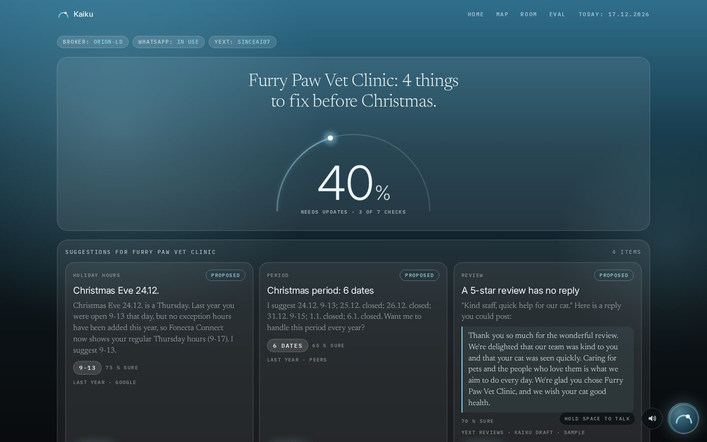
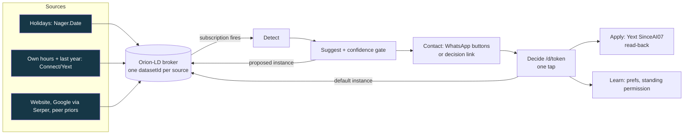

# Kaiku: Connect suggests, the customer approves

**Live:** <https://kaiku.hankintaviikko.fi> (phone and laptop) | **Demo video:** to be added at submission (YouTube) | **Repo:** github.com/oroomi/kaiku
**Challenge:** Fonecta, "Connect suggests, customer approves" | **Partner technology:** FIWARE (Orion-LD NGSI-LD broker, Smart Data Models)
**Team:** VY7, solo (Dayo) with Claude coding tools



## 30 seconds
**Problem (Fonecta's words).** Customers forget one-off changes like holiday hours, search results show outdated information, and people turn up when the business is closed.
**What it does.** Kaiku runs the whole chain for holiday hours: Detect, Suggest, Contact (no login, says why), Decide (one tap, the customer has the last word), Apply (written to the team's Yext sandbox entity SinceAI07, with a read-back check). It asks instead of guessing when it is unsure, and it says "no change needed" when nothing is wrong.
**Try it.** Open the live URL, press the run button for 24.12.2026 Jouluaatto. A FIWARE broker subscription fires, a suggestion appears with its reasons, a decision link is created, and after you tap Hyväksy (Approve) on the decision page the hours are written to Yext and read back. Choose 8.11.2026 Isänpäivä to see the "no change" answer.



## The demo path (what to click)
1. Open `/`. The headline shows the Christmas Eve gap and the event strip shows the broker subscription firing (Tilaus laukesi / Subscription fired). The clock is the time travel date, 17.12.2026.
2. Choose "24.12.2026 Jouluaatto" and run the chain. Events appear in order: broker, detect, suggest, contact.
3. When WhatsApp is not configured (or not reachable) the contact step says "WhatsApp ei ole vielä käytössä, päätöslinkki valmis" (WhatsApp is not in use yet, decision link ready) and gives the link `/d/<token>`. Open it on a phone.
4. Tap Hyväksy (Approve), Muokkaa (Edit) or Ei kiitos (No thanks). The page follows the apply event and shows where it appears. The Yext write is verified by reading the entity back.
5. Run the same date again after an edit or a decline: the learned preference changes the next suggestion. A "standing permission" tick lets Kaiku apply that holiday next time.
6. Set time travel to 2.11.2026 and run Isänpäivä 8.11.: the answer is "no change", shown as a result, not silence.
7. `/room` shows a QR code, `/join` on a phone makes you the owner of one real Turku business; `/map` shows the dots change as people answer (answers are demo data, not written to Yext). `/aura` shows live Turku buses, ships and weather as broker entities. Hold space and speak to Kaiku on any page.

## Run it in 3 commands
```bash
git clone https://github.com/oroomi/kaiku && cd kaiku
python3 -m venv .venv && .venv/bin/pip install -r requirements.txt
.venv/bin/uvicorn kaiku.app:app --host 127.0.0.1 --port 8210   # http://127.0.0.1:8210
```
Optional, in `.env` (never committed): `YEXT_API_KEY` (sandbox write), `WA_TOKEN`, `WA_PHONE_ID`, `OWNER_WHATSAPP`, `ANTHROPIC_API_KEY` and `ELEVENLABS_API_KEY` (voice), `SERPER_API_KEY` (Google signal, a Serper places lookup in `kaiku/detect/signals.py`). Without them the chain still runs and each lane says what is missing.
FIWARE spine: `docker-compose -f kaiku/broker/docker-compose.yml up -d` starts Orion-LD on 127.0.0.1:1026. Without it Kaiku uses an in-memory fallback broker and the events say "broker offline" (see [docs/broker.md](docs/broker.md), which also holds the judge curl).
Tests: `.venv/bin/pytest -q` (offline; 208 passed, 6 skipped on 6 Nov 2026; the live-sending tests are skipped unless `KAIKU_LIVE=1`). Suggestion CLI: `python -m kaiku.suggest.cli --business data/furry_paw.json --date 2026-12-24 --today 2026-12-17`.
Note: `requirements.txt` includes `-e ./ngsi-ld-mcp` and `mcp>=1.2,<2`, so the install above also gives the voice agent the broker tools (see [docs/mcp.md](docs/mcp.md)).
WhatsApp: the Meta WhatsApp Cloud API token (test number +1 555 188 5173, Meta test WABA) was configured on 6 Nov 2026 at 20:19Z. Test messages went only to the team's own phone (the owner number in demos is a team member's own, with consent), and Meta's delivery callbacks are stored in `data/wa_status.jsonl`. Free-form and button messages only deliver inside Meta's 24 hour customer-service window (the owner's phone must message the test number first); templates deliver at any time. The Finnish utility template `kaiku_hours_fi` with three quick-reply buttons was submitted on 6 Nov 20:28Z and is pending Meta approval; the code path exists behind `WA_TEMPLATE_NAME` and is off until approval ([docs/whatsapp.md](docs/whatsapp.md)).
Security: the public events feed and suggestion endpoints do not carry the owner's decision link unless the viewer holds the demo key (cookie set by `?key=`, or the `X-Kaiku-Key` header). httpx request logging is off so API keys never reach the journal. The demo reset also clears pending MCP proposals.

## What runs
| Part | Where | Doc |
|---|---|---|
| Chain (detect, suggest, contact, decide, apply, learn), SSE events, SQLite | `kaiku/` | [docs/core.md](docs/core.md) |
| Detect and Suggest, confidence gate, cold start | `kaiku/detect`, `kaiku/suggest` | [docs/suggest.md](docs/suggest.md) |
| Orion-LD spine: subscriptions, datasetId per source | `kaiku/broker` | [docs/broker.md](docs/broker.md) |
| Contact: WhatsApp Cloud API, buttons Hyväksy / Muokkaa / Ei kiitos | `kaiku/contact` | [docs/contact.md](docs/contact.md) |
| Decide: one-tap page `/d/<token>` | `kaiku/decide` | [docs/decide.md](docs/decide.md) |
| Apply: Yext sandbox write, read-back, snapshot, revert, reset | `kaiku/apply` | [docs/apply.md](docs/apply.md) |
| Learn: preferences, standing permission, time travel clock | `kaiku/learn` | [docs/learn.md](docs/learn.md) |
| Voice: ElevenLabs STT/TTS, Anthropic claude-sonnet-5-5 brain | `kaiku/voice` | [docs/voice.md](docs/voice.md) |
| Map and room: 813 real OSM Turku businesses, QR join | `kaiku/map` | [docs/map.md](docs/map.md) |
| Aura: Föli buses, AIS ships, Open-Meteo as Smart Data Models entities | `kaiku/aura` | [docs/aura.md](docs/aura.md) |
| ngsi-ld-mcp: standalone MCP server, agents propose, humans approve | `ngsi-ld-mcp/` | [docs/mcp.md](docs/mcp.md) |
| Call lane (ElevenLabs outbound Finnish call) | `kaiku/contact/call.py` | implemented but not working: the latest attempt (6 Nov 20:23Z) failed with SIP 488 Not Acceptable Here through the ElevenLabs SIP trunk to Zadarma. The WhatsApp step escalates to the call after `WA_ESCALATE_AFTER_S` seconds (default 120, the demo config sets 600). See DISCLOSURE.md |

Submission texts: [docs/SUBMISSION.md](docs/SUBMISSION.md). Data sources: [docs/DATA_SOURCES.md](docs/DATA_SOURCES.md). Cold start: [docs/COLD_START.md](docs/COLD_START.md). Final customer messages: [docs/final_messages.md](docs/final_messages.md). Deck text: [docs/DECK.md](docs/DECK.md).

## Architecture
The broker is the spine. Each source that has an opinion about a holiday writes its own instance of the `holidayHours` attribute (a `datasetId` per source). A subscription fires Detect, the engine adds a `proposed` instance, the owner's tap writes the default instance, and Apply writes Yext. The Yext write never depends on the broker. Details: [ARCHITECTURE.md](ARCHITECTURE.md).

## Evaluation: does it work?
Honest answer: on 10 cases we wrote ourselves, wrong-suggestion rate 0.0 and abstain rate 0.2. That is a self-consistency check, not accuracy. We have no Fonecta dataset or scoring script yet. See [EVAL.md](EVAL.md).

## Disclosure
All application code was written after the bell commit e2f7382 (6 Nov 2026 18:49Z). Brought: our MIT library voice-pilot (vendored), public data and services. See [DISCLOSURE.md](DISCLOSURE.md).

## Libraries and licences
FastAPI 0.162, Starlette, Uvicorn, Pydantic, Jinja2, httpx, python-dotenv, PyYAML, qrcode (all BSD, MIT or similar permissive); Anthropic SDK (MIT); Playwright (Apache-2.0, used for screenshots); MapLibre GL JS 4.7.1 (BSD-3-Clause, vendored); mcp Python SDK (MIT); Orion-LD (AGPL-3.0, run unmodified as a Docker image, not linked); MongoDB (run as a container image); fonts Inter, Newsreader, IBM Plex Mono (SIL OFL, vendored). Data licences are in [docs/DATA_SOURCES.md](docs/DATA_SOURCES.md).

## Pilot
Eight weeks with Fonecta Connect on real exception-hours data: [PILOT.md](PILOT.md).

## Team
VY7, solo: Dayo (product, pitch, phone). Code written with Claude Code (Fable orchestrating, Sonnet builders and verifiers).
