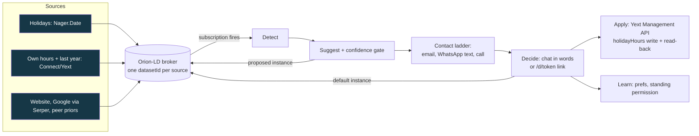

# Kaiku: Connect suggests, the customer approves

**What and for whom.** Kaiku is the whole chain for holiday hours (Detect, Suggest, Contact, Decide, Apply) for the owner of a small business whose opening hours Fonecta Connect publishes. The owner gets a message instead of a login, answers in plain words ("yes", "make it 10-14", "no thanks"), and the approved hours are written to Fonecta's Yext sandbox. The demo business is the **fictional** Furry Paw Vet Clinic, Fonecta's sandbox entity SinceAI07 in Vantaa.

**Live:** <https://kaiku.hankintaviikko.fi> (phone and laptop) | **Demo video:** to be added at submission (YouTube) | **Repo:** github.com/oroomi/kaiku
**Challenge:** Fonecta, "Connect suggests, customer approves" | **Partner technology:** FIWARE (Orion-LD NGSI-LD broker) | **Team:** VY7, solo (Dayo) with Claude coding tools


(Screenshot of the earlier home; the owner page changed on 7 Nov, see [docs/owner.md](docs/owner.md).)

## Run it in 3 commands
```bash
git clone https://github.com/oroomi/kaiku && cd kaiku
python3 -m venv .venv && .venv/bin/pip install -r requirements.txt
.venv/bin/uvicorn kaiku.app:app --host 127.0.0.1 --port 8210   # http://127.0.0.1:8210
```
Without keys the chain still runs and each lane says what is missing. Tests: `.venv/bin/python -m pytest -q` gives 308 passed, 6 skipped (run 7 Nov 2026; the skipped ones send or fetch live and need `KAIKU_LIVE=1`). The suite sets `KAIKU_NO_SMTP=1`, `KAIKU_FEED_NETWORK=0` and an empty `WA_TOKEN`, so it never sends or fetches.

## The three hard questions
1. **Who is it for?** The owner of a small business whose hours Fonecta Connect publishes and who forgets one-off changes such as holiday hours (a vet, a cafe, a salon). Not chains with a marketing team. The demo owner is fictional.
2. **What was built this weekend?** Everything in this repo from the bell commit `e2f7382` (6 Nov 2026 18:49:59Z) on, except what [DISCLOSURE.md](DISCLOSURE.md) lists as brought: our MIT voice-pilot (vendored), `/root/hack/bin` process scripts, public APIs and data, the Yext sandbox, our VPS and Cloudflare tunnel.
3. **What breaks first at scale?** The suggestions engine fetches signals per business on every build (the business website and Google via Serper, per holiday). On 7 Nov 2026 one build for the demo clinic made 6 HTTP calls and took 1.6 s warm; with more holidays in view and a real website the number and the cold time grow per business, and the result is cached only 30 s. That is the first wall; the chat paints its first screen on the quick path without network signals for this reason. Second: our Orion-LD build cannot update a datasetId instance in place (see [ARCHITECTURE.md](ARCHITECTURE.md)).

## What the owner sees (`/`)
Status chips; one sentence with the arc and Connect versus Kaiku; **Chat with Kaiku** (opens with Kaiku's intro and one bubble per suggestion; the owner answers in words, there are no buttons; the voice orb feeds the chat); **Message to the owner** (the thread of everything Kaiku sent and every reply, labelled EMAIL / WHATSAPP / CALL / WEB); **Suggestions for Furry Paw Vet Clinic** (one card per feed item: holiday hours, conflicting sources, holiday periods, no change). Description and review suggestions exist in the engine, but the sandbox entity has no description and zero reviews, so they show nothing. Demo controls (time travel, holiday picker, Run the chain, Reset) are in the keyed drawer `/?key=...#drawer`; `/judge` (keyed) shows live events, broker, WhatsApp and Yext chips and the Yext read-back.

## Contact ladder
1. **Email** with the decision link (SMTP via Zoho, address from `OWNER_EMAIL`). Live proof: sent 2026-11-06T23:48:04Z, suggestion `1e5f6eff7a` (`data/email_log.jsonl`).
2. After `EMAIL_ESCALATE_AFTER_S` (60 s in the live config, code default 120) with no decision: **one plain WhatsApp text**. It is the same conversation as the website chat: replies go to the same brain and the same decision path; buttons only with `WA_BUTTONS=1`. Live proof: text sent 2026-11-06T23:49:08Z (`data/wa_sends.jsonl`); earlier a WhatsApp tap wrote to Yext at 20:42Z ([docs/whatsapp.md](docs/whatsapp.md)).
3. After `WA_ESCALATE_AFTER_S` (code default 120; the live config sets 36000 so the phone does not ring unprompted): **a phone call by Kaiku** (ElevenLabs agent over a Zadarma SIP trunk, English). Live proof: call answered, owner approved, Yext write at 21:46:53Z, `data/call_log.jsonl` ([docs/call.md](docs/call.md)).
A decision on any channel cancels the next step.

## The brain
Anthropic claude-sonnet-5-5 with three tools (decide, standing permission, ask), a 40-word reply cap, and a deterministic keyword parser that answers when the model is unavailable. After an approval it asks once: "Want me to do this every Christmas Eve?" ([docs/whatsapp.md](docs/whatsapp.md), `kaiku/chat/brain.py`).

## Demo path
Set the clock to 17.12.2026 (the live default). Open `/`: the chat shows Christmas Eve 24.12. 9-13 against Connect's 9-17, "75 % sure", and the Christmas period of 6 dates, 24.12. to 6.1. Say "yes" in the chat (or in the WhatsApp text or the email link): the hours are written to Yext and read back, then Kaiku asks about standing permission. With the clock at 7.11. the cards show Father's Day 8.11. as "no change needed" (a flag day, the clinic is closed on Sundays). Details: [DEMO_SCRIPT.md](DEMO_SCRIPT.md).

## Architecture

The broker is the spine: each source writes its own instance of `holidayHours` (a `datasetId` per source); a subscription fires Detect, the engine adds a `proposed` instance, the owner's answer writes the default instance, and Apply writes Yext. The Yext write never depends on the broker (`broker/fallback.py`). Apply uses the Yext Management API directly; the Yext Suggestions API returns 403 for the sandbox key ([docs/apply.md](docs/apply.md)). Details: [ARCHITECTURE.md](ARCHITECTURE.md).

## Evaluation
Honest answer: on 10 cases we wrote ourselves, wrong-suggestion rate 0.0 and abstain rate 0.2. That is a self-consistency check, not accuracy; we have no Fonecta dataset or scoring script yet. Reliability in the product: a confidence gate (a suggestion is shown only when it is at least 75 % sure, otherwise Kaiku asks), "no change" shown as a note, and a question instead of a guess when sources conflict. See [EVAL.md](EVAL.md).

## Disclosure
All application code was written after the bell commit e2f7382. Brought: our MIT voice-pilot (vendored), `/root/hack/bin` scripts, public data and services, the Yext sandbox, our VPS. See [DISCLOSURE.md](DISCLOSURE.md).

## Configuration and services
Optional, in `.env` (never committed): `YEXT_API_KEY`, `ANTHROPIC_API_KEY`, `ELEVENLABS_API_KEY`, `SERPER_API_KEY`, `SMTP_HOST`/`SMTP_USER`/`SMTP_PASS`/`SMTP_FROM`, `OWNER_EMAIL`, `OWNER_WHATSAPP`, `WA_TOKEN`, `WA_PHONE_ID`, `EMAIL_ESCALATE_AFTER_S`, `WA_ESCALATE_AFTER_S`. FIWARE spine: `docker-compose -f kaiku/broker/docker-compose.yml up -d` starts Orion-LD on 127.0.0.1:1026; without it an in-memory fallback runs and events say "broker offline" ([docs/broker.md](docs/broker.md)).
WhatsApp: Meta Cloud API test number, messages only to the team's own phone; free-form text delivers only inside Meta's 24 hour window; the templates `kaiku_hours_fi` and `kaiku_hours_en` were submitted on 6 Nov and were pending at last check. Security: the public events feed and suggestion endpoints omit the decision link unless the viewer holds the demo key; httpx request logging is off.

## What runs
| Part | Where | Doc |
|---|---|---|
| Chain, SSE events, SQLite | `kaiku/` | [docs/core.md](docs/core.md) |
| Owner page: chat, thread, suggestion cards | `kaiku/chat`, `kaiku/web` | [docs/owner.md](docs/owner.md) |
| Detect and Suggest, confidence gate, cold start | `kaiku/detect`, `kaiku/suggest` | [docs/suggest.md](docs/suggest.md) |
| Orion-LD spine | `kaiku/broker` | [docs/broker.md](docs/broker.md) |
| Contact ladder: email, WhatsApp, call | `kaiku/contact` | [docs/contact.md](docs/contact.md), [docs/whatsapp.md](docs/whatsapp.md), [docs/call.md](docs/call.md) |
| Decide: chat or `/d/<token>` | `kaiku/decide`, `kaiku/chat` | [docs/decide.md](docs/decide.md) |
| Apply: Yext write, read-back, snapshot, revert | `kaiku/apply` | [docs/apply.md](docs/apply.md) |
| Learn: preferences, standing permission, clock | `kaiku/learn` | [docs/learn.md](docs/learn.md) |
| Voice | `kaiku/voice` | [docs/voice.md](docs/voice.md) |
| Map and room (813 real OSM Turku businesses) | `kaiku/map` | [docs/map.md](docs/map.md) |
| Aura (FIWARE entry) and ngsi-ld-mcp | `kaiku/aura`, `ngsi-ld-mcp/` | [docs/aura.md](docs/aura.md), [docs/mcp.md](docs/mcp.md) |

Submission texts: [docs/SUBMISSION.md](docs/SUBMISSION.md). Data sources: [docs/DATA_SOURCES.md](docs/DATA_SOURCES.md). Cold start: [docs/COLD_START.md](docs/COLD_START.md). Final messages: [docs/final_messages.md](docs/final_messages.md). Deck: [docs/DECK.md](docs/DECK.md).

## Libraries and licences
FastAPI 0.162, Starlette, Uvicorn, Pydantic, Jinja2, httpx, python-dotenv, PyYAML, qrcode (all BSD, MIT or similar permissive); Anthropic SDK (MIT); Playwright (Apache-2.0, used for screenshots); MapLibre GL JS 4.7.1 (BSD-3-Clause, vendored); mcp Python SDK (MIT); Orion-LD (AGPL-3.0, run unmodified as a Docker image, not linked); MongoDB (run as a container image); fonts Inter, Newsreader, IBM Plex Mono (SIL OFL, vendored). Data licences are in [docs/DATA_SOURCES.md](docs/DATA_SOURCES.md).

## Pilot
Eight weeks with Fonecta Connect on real exception-hours data: [PILOT.md](PILOT.md).

## Team
VY7, solo: Dayo (product, pitch, phone). Code written with Claude Code (Fable orchestrating, Sonnet builders and verifiers).
